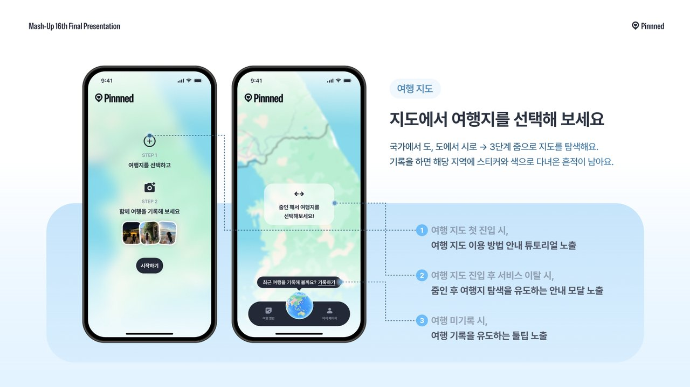
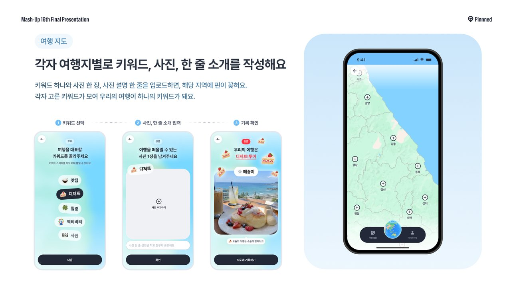
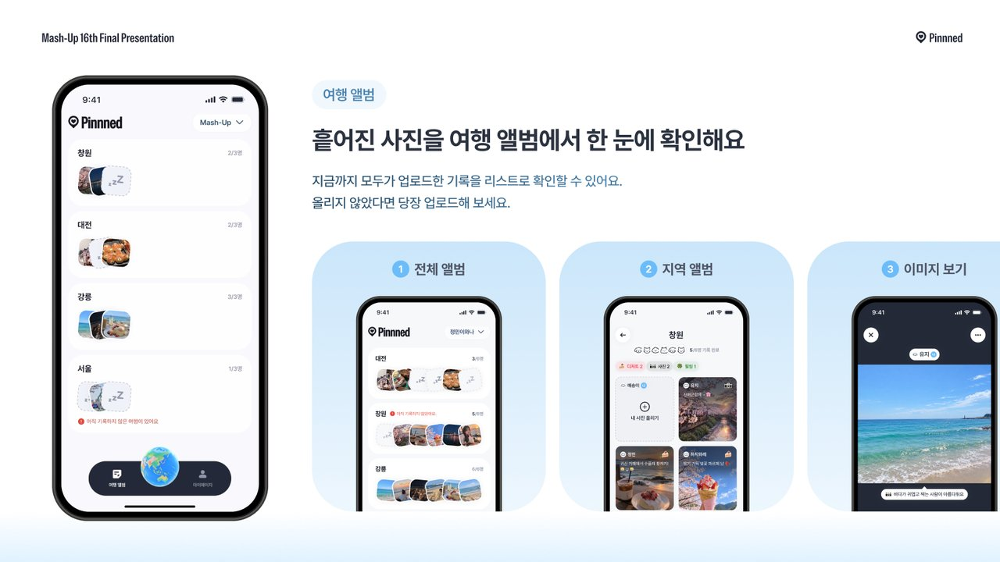
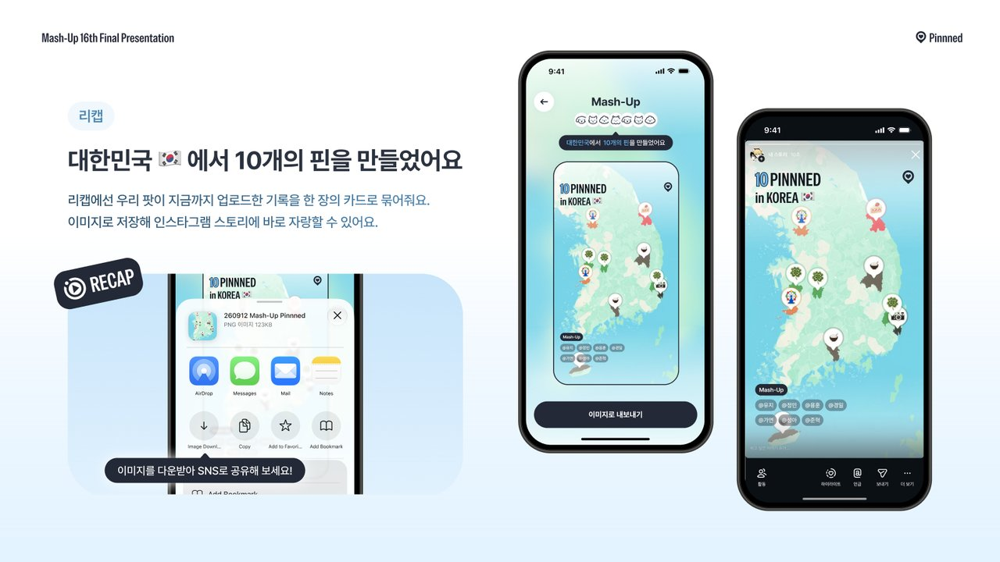

# Pinnned


**우리, 어디까지 같이 가봤지?**

Pinnned는 친구·연인·가족과 함께 다녀온 여행을 스티커와 사진으로 지도 위에 같이 기록하는 여행 기록 서비스입니다.
한국 지도 위에 우리 팟이 다녀온 지역마다 스티커가 하나씩 쌓입니다.

🔗 **https://www.pinnned.co.kr** (모바일 웹 · PWA)

<br/>

## 왜 만들었나

같이 여행을 다닐수록 함께한 장소는 늘어나는데, 시간이 지나면 "우리 어디 갔었지?"가 됩니다.
사진은 각자 폰에, 장소는 기억 어딘가에 흩어져 있어 **우리가 다녀온 여행을 하나의 기록으로 돌아보기** 어렵습니다.

기존 서비스는 사진 기록, 지도 위 기록까지는 잘 지원하지만 두 가지가 비어 있었습니다.

- 친구·여행팟 단위로 기록이 **누적**되는 것
- **함께** 기록하는 경험

Pinnned는 이 두 칸을 채웁니다. 우리만의 여행팟을 만들고, 여행지마다 사진 한 장과 키워드를 지도에 남기고, 여행 앨범에서 함께한 기록을 같이 돌아봅니다.

<br/>

## 핵심 기능

### 1. 여행팟

가족·연인·친구와 우리만의 여행팟을 만듭니다. 초대코드로 최대 6명까지 함께하고, 팟 여러 개에 동시에 속할 수 있습니다.

### 2. 여행 지도



국가 → 도 → 시, 3단계 줌으로 지도를 탐색합니다. 기록을 남기면 해당 지역에 스티커와 색으로 다녀온 흔적이 남습니다.
첫 진입 튜토리얼, 기록 없이 돌아왔을 때의 "기록하기" 툴팁으로 첫 기록을 유도합니다.

### 3. 지도에 같이 기록하기



여행지마다 **키워드 하나 + 사진 한 장 + 한 줄 소개**를 남기면 핀이 꽂힙니다.
팟원 각자가 고른 키워드가 모여 "우리의 여행은 디저트 투어"처럼 우리 여행의 대표 키워드가 됩니다.

### 4. 여행 앨범



흩어진 기록을 한눈에 봅니다. 전체 앨범 → 지역 앨범 → 사진 뷰어로 들어가며, 팟원별 사진과 한 줄 소개를 확인합니다.
아직 안 올린 지역은 빈 자리로 보여서 자연스럽게 "너도 올려"가 됩니다.

### 5. 리캡



지금까지 우리 팟이 만든 핀을 한 장의 카드로 묶어 이미지로 저장합니다. 인스타그램 스토리에 바로 올릴 수 있는 규격입니다.

<br/>

## 기술

| 영역   | 스택                                                                       |
| ------ | -------------------------------------------------------------------------- |
| 프론트 | TanStack Start(SSR) · React 19 · TypeScript · Tailwind 4 · shadcn/ui · PWA |
| 지도   | Google Maps · TopoJSON(빌드 시 단순화) → GeoJSON 지역 경계 레이어          |
| 데이터 | GraphQL ([udumeoli-spring](https://github.com/mash-up-kr/udumeoli-spring)) |
| 구조   | FSD 레이어: `app · pages · widgets · features · entities · shared`         |
| 품질   | Vitest · ESLint · Storybook · Playwright 스크린샷(`pnpm ui:shot`)          |

- 지역 경계 데이터는 **Promise 자체를 모듈 스코프에 캐싱**해 지도 안팎에서 동시에 호출해도 한 번만 내려받고, 실패 시 캐시를 비워 재시도가 가능하게 했습니다.
- 지도 집계 API 하나가 줌 0~3단계 데이터를 한 번에 내려줘 줌·이동 시 재호출이 없습니다.

<br/>

## 팀

Mash-Up 16기 **우두머리** 팀

| Design         | Web            | Spring                 |
| -------------- | -------------- | ---------------------- |
| 이유지, 홍정민 | 이용훈, 최경일 | 이가연, 조성아, 최준혁 |

<br/>

## 개발

```bash
pnpm install
pnpm dev          # http://localhost:3000
pnpm storybook    # http://localhost:6006

pnpm typecheck · pnpm lint · pnpm test · pnpm build
pnpm ui:shot <route> [--measure "<sel>"]   # 화면 스크린샷 → .ui-shots/
```

`.env.example`을 복사해 `.env.local`을 만들고 API·지도 키를 채웁니다.

### Analytics

Set `VITE_ANALYTICS_API_URL` to the Analytics server origin before running the
web app:

```bash
VITE_ANALYTICS_API_URL=https://pinnned-analytics-production.up.railway.app
```

The web app sends `page_view`, `session_started`, `login_completed`,
`pot_created`, `pot_joined`, `travel_record_created`, `map_viewed`, and
`travel_album_viewed` events to `/api/events`. Analytics requests are
fire-and-forget and failures do not affect product flows.

Google Analytics (`G-0D3HZ92ZME`) loads in production builds only. Enable
**Enhanced measurement → Page views → Page changes based on browser history
events** in the GA web data stream to measure SPA navigation. GA page views use
automatic measurement; the existing `/api/events` analytics remains separate.
GA initializes after hydration and waits until the login callback has completed
to avoid collecting its one-time code. Referrers are reduced to their origin.

<br/>


